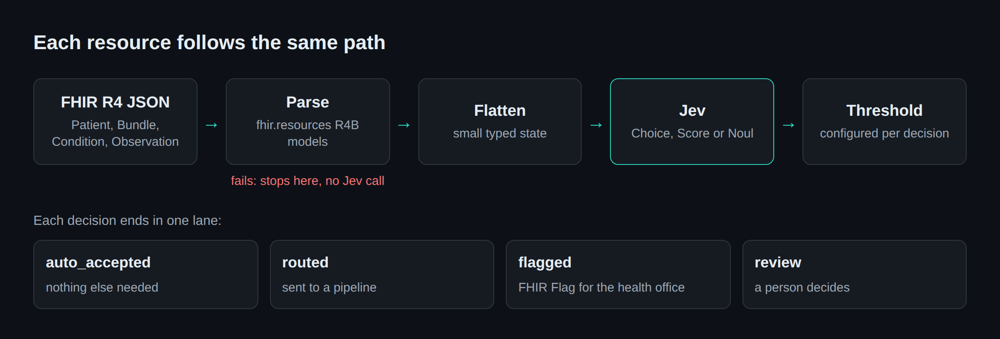
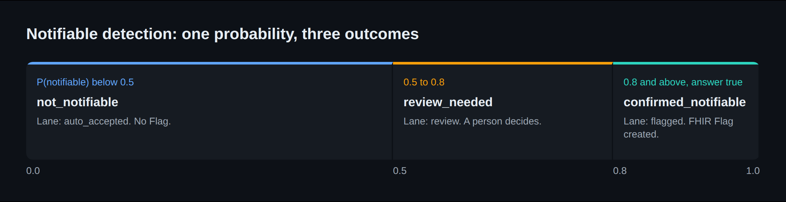

A FHIR resource can pass validation and still be the wrong thing to act on. I built a small decision layer for that gap: it takes parsed FHIR R4 resources, sends a flattened state to TypeSafe AI's Jev model, and turns the answer into accept, route, flag or human review.

On 204 synthetic records, the live model beat my hand-written rules on two decisions and lost on the third. It also missed my latency target by a wide margin. The most useful result was a bug in my own serializer, which the accuracy score did not reveal.

This is a proof of concept. It runs on synthetic data and it is not connected to any production system.

## What validation does not answer

Here is part of a Patient that parses as FHIR R4:

```json
{
  "resourceType": "Patient",
  "id": "invalid-nik",
  "identifier": [{"system": "nik", "value": "317301010190000"}],
  "name": [{"family": "Wijaya"}]
}
```

The NIK is Indonesia's national ID, and it has 16 digits. This one has 15. A Condition can have the same problem in a different form: well-formed, coded as dengue, with `verificationStatus` set to `refuted`. The patient does not have dengue, and the resource is still structurally correct.

Conformance checking answers one question: does this resource meet the spec? A pipeline has to answer a different one: what should happen to this resource now?

| | Conformance | Decision layer |
| --- | --- | --- |
| Question | Does it meet the spec? | What do we do with it? |
| Output | Pass or fail, with issues | An action and a confidence |
| Defined by | Spec and profiles | Workflow and risk tolerance |
| When unsure | Does not apply | Sends it to a person |

Profiles can cover more of this than people expect. A FHIRPath invariant could enforce a 16-digit NIK, so that example does not need a model. The boundary I care about is not rules versus AI. It is *is this correct?* versus *what happens next?*

## The pipeline

Jev is a decision model. It takes a structured state and a fixed question, and returns a typed answer with a confidence. It does not generate text. The project uses its three primitives: **Choice** picks one option from a list, **Score** returns a number on a scale, and **Noul** answers a statement with a probability that it is true.



The service is FastAPI with Pydantic v2, and it makes three decisions:

| Decision | Primitive | Output |
| --- | --- | --- |
| Is this resource good enough to accept automatically? | Score, plus Noul for the NIK | Score 0 to 100, then accept or review |
| Which pipeline should get this Bundle? | Choice | One of five fixed categories |
| Must this Condition be reported? | Noul | Probability, plus a Flag when confirmed |

## Conformance runs first, then the state gets small

Every serializer parses the resource before it extracts anything. A resource that fails parsing raises an error, so no Jev call happens. This is lighter than full profile and terminology validation, but the order is the design: conformance first, decisions on top.

```python
# src/jev_fhir/serializer/patient.py
def serialize(self, resource: dict[str, Any]) -> dict[str, Any]:
    """Validate a Patient and produce a missing-field-safe flat state."""
    Patient.parse_obj(resource)

    identifier = first_mapping(resource.get("identifier"))
    identifier_value = identifier.get("value") if identifier is not None else None

    return {
        "resource_type": self.resource_type(),
        "has_identifier": identifier is not None,
        "identifier_value_length": len(identifier_value)
        if isinstance(identifier_value, str)
        else None,
        # remaining demographic fields omitted
    }
```

The model never receives the NIK itself, only its length. This is the state produced from the full version of that Patient:

```json
{
  "resource_type": "Patient",
  "has_identifier": true,
  "identifier_system": "nik",
  "identifier_value_length": 15,
  "has_name": true,
  "name_family": "Wijaya",
  "has_birth_date": true,
  "has_gender": true,
  "has_address": true,
  "address_country": "ID",
  "has_telecom": false,
  "telecom_count": 0,
  "field_completeness": 8,
  "field_total": 10
}
```

A small state keeps each call cheap and easy to inspect. The demo UI shows this exact state next to every decision, which made debugging much easier later. It is not a privacy solution, though. `name_family` is still in there, and real data would need a proper review.

## A probability is not an action

Thresholds turn a model output into something the pipeline can do. The router has a confidence floor, and anything below it becomes `unknown`:

```python
# src/jev_fhir/modules/bundle_router.py
state = self._serializer.serialize(bundle)
result = await self._jev_client.choice(state, ROUTE_QUESTION, ROUTE_OPTIONS)
category = result.choice if result.confidence >= confidence_minimum else "unknown"
```

The quality scorer treats the NIK as a gate. A high completeness score cannot override it:

```python
# src/jev_fhir/modules/quality_scorer.py
passes_nik_gate = nik_valid is not False
action = (
    "auto_accept"
    if score_result.score >= threshold and passes_nik_gate
    else "review_needed"
)
```

Notifiable detection uses two thresholds, which gives it a band for human review:



```python
# src/jev_fhir/modules/notifiable_detector.py
if result.probability >= confirmed_threshold and result.answer:
    status = "confirmed_notifiable"
    is_notifiable = True
    # builds the FHIR Flag here
elif result.probability >= review_threshold:
    status = "review_needed"
    is_notifiable = False
    flag_resource = None
else:
    status = "not_notifiable"
    is_notifiable = False
    flag_resource = None
```

The review band is the part conformance has no equivalent for. The system can say it is not sure, and that outcome has a defined place to go.

## How I measured it

I compared Jev with a transparent rule baseline for each decision. The rules are deliberately simple: a field-count score, a length check for the NIK, routing on resource types and LOINC signals, and an exact ICD-10 lookup.

The dataset has 204 labelled fixtures, including a hard set built to separate semantic judgment from exact matching. Labels are never computed from the logic under test. The test suite uses a mock Jev client and never calls the live API, and the benchmark runs against the live model only when I ask it to.

| Decision | Fixtures | Jev | Rules | My target |
| --- | ---: | ---: | ---: | --- |
| Quality (accuracy) | 71 | **0.648** | 0.549 | ≥ 0.85, missed |
| Routing (accuracy) | 102 | 0.814 | **0.922** | ≥ 0.90, missed |
| Notifiable (accuracy) | 31 | **0.935** | 0.677 | none set |
| Notifiable (recall) | 31 | **0.895** | 0.579 | ≥ 0.95, missed |
| Notifiable (precision) | 31 | **1.000** | 0.846 | ≥ 0.80, met |

## The bug the state panel exposed

My first live run scored 0.839 on notifiable detection, with a recall of 0.737. The score alone gave no hint of why.

The cause showed up while I was reviewing the demo. The state panel for a text-only dengue case showed `code_value`, `code_display` and `code_system` all null, with no disease name anywhere. My serializer read `code.coding` and never read `code.text`, so the model was judging a blank. Three of the five misses had the disease name only in `code.text`, such as "Demam berdarah dengue (DBD)" and "TB paru".

The fix is small:

```diff
# src/jev_fhir/serializer/condition.py
+CODE_TEXT_MAX_LENGTH = 200

         code = resource.get("code")
+        code_text = code.get("text") if isinstance(code, dict) else None
         onset = resource.get("onsetDateTime")

             "code_display": first_coding_value(code, "display"),
+            "code_text": code_text[:CODE_TEXT_MAX_LENGTH] if isinstance(code_text, str) else None,
             "clinical_status": first_coding_code(resource.get("clinicalStatus")),
```

The 200-character limit keeps a long note from inflating token use and limits how much free text leaves the system. I kept the rule baseline code-only, so the comparison stayed fair. I also kept the mock code-only, because teaching it to read text would make mock results look like model evidence.

I then compared the two live reports row by row. Exactly three notifiable rows changed, and they were the three I expected:

| Fixture | Confidence before | Confidence after | Result |
| --- | ---: | ---: | --- |
| `dbd_text_only` | 0.47 | 0.90 | wrong → correct |
| `tb_paru_text_only` | 0.50 | 0.89 | wrong → correct |
| `condition_dbd_text_only` | 0.49 | 0.89 | wrong → correct |

Accuracy went from 0.839 to 0.935, and recall went from 0.737 to 0.895. The earlier score was measuring my pipeline, not the model. Without the row-level comparison, I could not have told that apart from noise, because quality accuracy moved from 0.676 to 0.648 between the same two runs on rows the fix does not touch.

The two remaining misses, `B20` HIV and typhoid `A01.0`, have proper codes. Both landed in the review band at 0.76 and 0.77, so a person would see them. All 19 notifiable cases were either confirmed or sent to review, and none was dismissed.

## Where each side won

Jev did best where the decision depends on more than one field. On the 14 hard Condition fixtures it scored 0.929 against 0.357 for the rules. The rules reported a refuted dengue case and a cholera record marked `entered-in-error` as real. Jev confirmed neither, and both went to review. It also caught dengue and tuberculosis coded only in SNOMED, which an ICD-10 lookup cannot see.

Some of that gap is cheap to close. Prefix matching would handle subcodes like `A15.0`, and checking `verificationStatus` would handle the refuted case. A serious rule set would do both.

Rules won routing because routing is mostly clear logic. They were right on 12 Bundles that Jev got wrong, and the reverse happened once. The errors have different shapes, though:

| Error | Jev | Rules |
| --- | ---: | ---: |
| Encounter Bundle returned as `unknown` | 12 | 0 |
| `unknown` Bundle sent to a real pipeline | 7 | 8 |

The first row costs a person some extra work. The second row is the dangerous one, and on that row Jev and the rules were about equal. Jev's seven came at 0.81 to 1.00 confidence, so the floor did not catch them. I have not diagnosed why those encounter Bundles score so low. For this decision I would use rules.

Quality scoring sits in between. Of 45 records that needed review, Jev let 15 through and the rules let 32 through. But Jev also held 10 of 26 good records, and the rules held none.

## Confidence only works where it is calibrated

A threshold is only useful if confidence means something, so the benchmark buckets decisions by confidence and compares that with observed accuracy. This is the top bucket:

| Decision | Count | Mean confidence | Observed accuracy |
| --- | ---: | ---: | ---: |
| Notifiable | 17 | 0.846 | 1.000 |
| Routing | 85 | 0.995 | 0.918 |
| Quality | 26 | 0.822 | 0.692 |

Notifiable looks trustworthy here. Quality does not: a confidence of 0.82 was right about 69% of the time, so I would not automate anything on that threshold yet.

## What it gets wrong

**Latency.** My target was a p50 under 30 ms. The live p50 was 235 ms for routing and notifiable, and 470 ms for quality, where a Patient takes two calls. The p95 ranged from 268 ms to 584 ms. These are client-side round trips from my machine, so they include the network, and I have not separated model time. The fast-decision premise is not proven by this data.

**Cost target.** The full run used 146,760 tokens for about $0.006. That is about $0.03 per 1,000 records, three times my $0.01 target. It is still very cheap.

**Evaluation quality.** No human has approved the labels yet. 124 are pending review, and the other 80 are correct by construction because a generator produced them. The hard sets are small. I also fixed the bug after seeing these same fixtures fail, so the 0.935 is not a held-out result. It needs confirming on data the system has not seen.

## What comes next

The first step is human review of the labels, because every number here depends on them. After that I want a held-out set for the notifiable decision, and a latency measurement that separates the network from the model. Two gaps from this work are still open: `ObservationSerializer` drops `code.text` the same way the Condition serializer did, and all the serializers read only the first `coding`.

The result I would keep is the shape of the system, more than any single score: parse first, flatten to a state a person can inspect, use a threshold per decision, give uncertain cases a lane, and keep a baseline that can beat the model. That baseline did beat it on routing, and the state panel is what exposed my own bug.

---

*I work on clinical data systems at a research unit, mostly FHIR R4, HL7 v2, and HAPI FHIR. This is a proof of concept for a typed decision layer over FHIR records: [REPO LINK].*

<!--
Before publishing (remove this block):
1. Replace [REPO LINK], and push the repo if readers should see this code.
2. Upload docs/dev-to-images/pipeline.png and notifiable-bands.png in the dev.to editor and replace both image paths. dev.to does not render Mermaid.
3. Add the demo video if wanted. dev.to embeds YouTube links with: 
4. Confirm TypeSafe AI is happy for these results to be published.
5. Cross-link: consider one sentence linking to https://dev.to/budiwidhiyanto/fhir-r4-for-ai-engineers-what-actually-lives-in-a-patient-record-1839

Numbers: live reports bench_20261031T150439Z (before) and bench_20261101T001036Z (after).

Cover image prompt (use your shared style block from FHIR_RAG/docs/article-dev.to/cover-image-prompts.md):
A horizontal flow of small document cards passing through a thin gate, then splitting into four labelled lanes, with one lane highlighted in amber for human review.
-->
